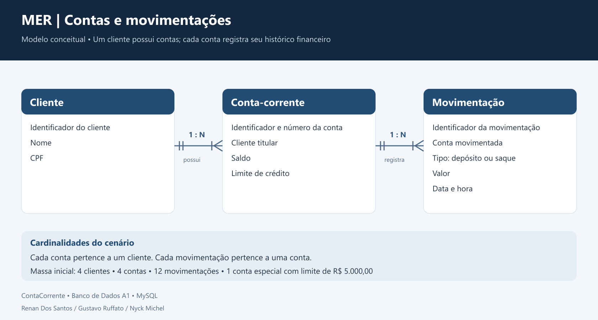
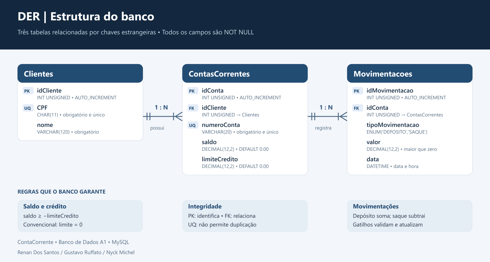

# ContaCorrente — MySQL

Projeto acadêmico de Banco de Dados para gerenciamento de clientes, contas-correntes e movimentações financeiras.

**Integrantes:** Renan Dos Santos, Gustavo Ruffato e Nyck Michel.

## Funcionalidades

- Cadastro de clientes e contas com relacionamentos 1:N.
- Depósitos e saques com atualização automática do saldo por gatilhos.
- Conta especial com limite de crédito de R$ 5.000,00.
- Bloqueio de saques que ultrapassem o saldo e o limite disponíveis.
- Perfis Administrador e Correntista com permissões distintas.
- Script idempotente que restaura a mesma massa de demonstração a cada execução.
- Consultas de histórico, saldos e totais de débitos e créditos por período.

## Estrutura

```text
.
├── ContaCorrente.sql          # Script principal: banco, usuários, regras e dados
├── Consultas.sql             # Consultas para demonstração
├── Testes_Manuais.sql         # Testes separados por bloco
├── RELATORIO_TESTES.md        # Evidências da validação realizada
└── docs/
    ├── ContaCorrente.mwb      # Modelo editável do Workbench
    ├── Modelo_Workbench.sql   # DDL para importar/recriar o modelo
    ├── MODELO.md              # Dicionário de dados e regras
    ├── MER.svg / MER.png      # Modelo conceitual
    └── DER.svg / DER.png      # Diagrama físico
```

## Executar

Requer MySQL **8.0.16 ou superior**, com InnoDB e restrições `CHECK` aplicadas. O SQL foi validado no **MySQL 8.4.13**.

1. Conecte ao servidor pelo Workbench usando uma conta de instalação, como `root`, com permissão para criar usuários e definir gatilhos.
2. Abra [ContaCorrente.sql](ContaCorrente.sql).
3. Execute o arquivo inteiro, incluindo os comandos `DELIMITER` dos gatilhos.
4. Confira os resultados e execute novamente para verificar a repetibilidade.
5. Use [Consultas.sql](Consultas.sql) para consultar os dados.

**Atenção:** cada execução do script principal apaga e recria o banco `ContaCorrente` e os usuários locais `Administrador` e `Correntista`. Utilize um ambiente acadêmico exclusivo.

## Usuários de demonstração

| Usuário | Host | Senha de demonstração | Permissões em `ContaCorrente.*` |
| --- | --- | --- | --- |
| `Administrador` | `localhost` | `Admin_A1#2026!` | Todos os privilégios |
| `Correntista` | `localhost` | `Conta_A1#2026!` | `SELECT` e `INSERT` |

Essas credenciais são exemplos públicos para uso local. Os gatilhos executam com os privilégios do administrador, permitindo atualizar os saldos sem conceder `UPDATE` diretamente ao correntista.

## Dados iniciais

São cadastrados quatro clientes, quatro contas e doze movimentações. Os CPFs são identificadores fictícios de teste; a validação verifica o formato de onze dígitos, sem calcular dígitos verificadores.

| Cliente | Conta | Saldo inicial da demonstração | Limite |
| --- | --- | --- | --- |
| Renan Dos Santos | 0001-1 | -R$ 700,00 | R$ 5.000,00 |
| Gustavo Ruffato | 0002-0 | R$ 1.350,25 | R$ 0,00 |
| Nyck Michel | 0003-8 | R$ 1.750,75 | R$ 0,00 |
| Ana Oliveira | 0004-6 | R$ 550,50 | R$ 0,00 |

As contas são criadas com saldo zero; os valores acima resultam das movimentações inseridas pelo script. Datas e valores ficam fixos para garantir o mesmo resultado nas reexecuções.

## Modelagem





Abra [ContaCorrente.mwb](docs/ContaCorrente.mwb) no Workbench para editar o modelo. Também é possível importar [Modelo_Workbench.sql](docs/Modelo_Workbench.sql) por **File > Import > Reverse Engineer MySQL Create Script**.

O [dicionário de dados](docs/MODELO.md) detalha campos, restrições e gatilhos. O DDL de modelagem contém a estrutura; o script principal reúne também usuários, regras financeiras e dados.

## Validação

Foram aprovadas **44 verificações** no MySQL 8.4.13, incluindo três execuções completas do script, controle de permissões, atomicidade e saques simultâneos. Consulte o [relatório](RELATORIO_TESTES.md).

O arquivo `.mwb` foi gerado pela API nativa do Workbench e teve sua integridade ZIP/XML conferida. A abertura e a execução pela interface do Workbench serão verificadas pela equipe em outro computador.

Execute [Testes_Manuais.sql](Testes_Manuais.sql) em blocos separados. Alguns comandos devem gerar erros para demonstrar as restrições; finalize cada bloco com `ROLLBACK`, inclusive após uma rejeição.

As operações financeiras devem passar por `Movimentacoes`. Alterações diretas no saldo pelo administrador podem produzir divergências com o histórico; uma consulta de conferência está disponível em `Consultas.sql`.
